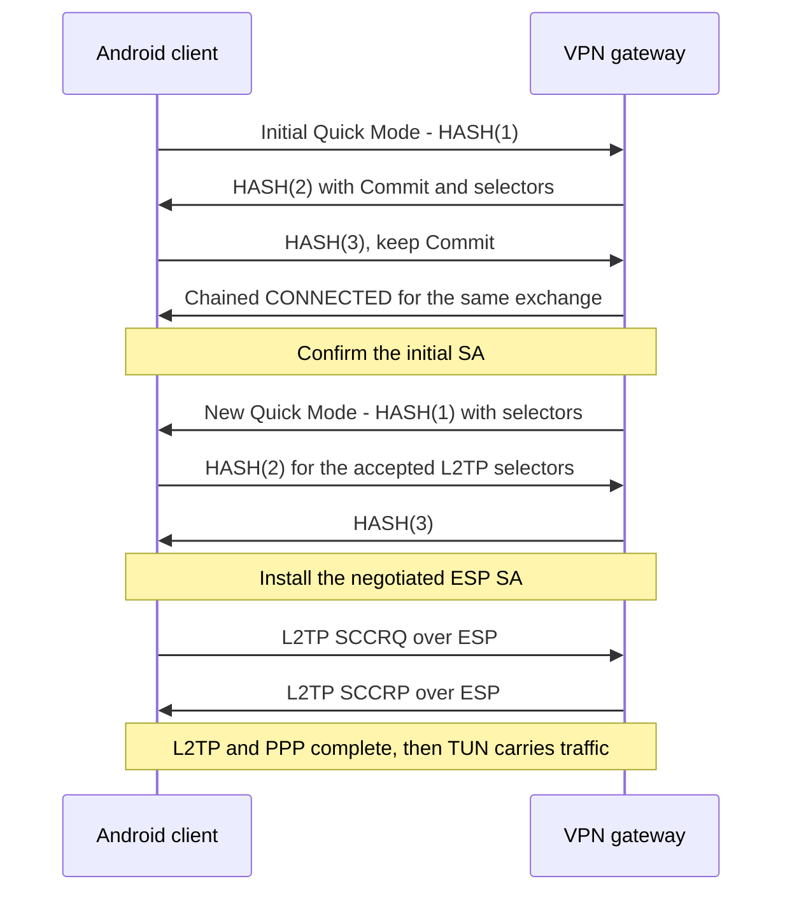

> **TL;DR：** iPhone 用系统自带的 VPN 就能连上，但这台 Android 15 已不能在系统设置里新建 L2TP/IPsec 配置。我们改用开源客户端 TunnelForge，实测握手超时后才 fork 源码。修复了 IKEv1 Quick Mode 的确认处理，以及网关发起新一轮协商时的 NAT 地址匹配，最后在真机上验证了双向隧道流量。

2026 年 11 月 27 日，我们想让一台 TECNO KM9（Android 15）接入已有的 L2TP/IPsec PSK VPN。iPhone 用 iOS 自带的 VPN 功能就能配置 L2TP over IPsec，实际连接正常；Mac 用同一套设置也能连上。轮到 Android 时，第一步就卡住了：系统 VPN 设置里没有这种类型。

## 1. 系统不能直接配，才开始找客户端

[Apple 的部署文档](https://support.apple.com/guide/deployment/vpn-overview-depae3d361d0/web)把 L2TP over IPsec 列在内置支持的协议里。Android 的系统设置走了另一条路：[Android 12 的 AOSP 设置](https://android.googlesource.com/platform/packages/apps/Settings/+/android-12.0.0_r1/src/com/android/settings/vpn2/ConfigDialog.java)开始限制新建旧式 VPN，启用新版网络设置时会过滤 L2TP/IPsec 等旧类型。到了 [Android 15](https://android.googlesource.com/platform/packages/apps/Settings/+/android-15.0.0_r1/src/com/android/settings/vpn2/ConfigDialog.java)，AOSP 的新建菜单只列出 IKEv2/IPsec 类型，和这台 TECNO 上的实测一致。`IKEv2/IPsec PSK` 里的 PSK 是认证方式，选了它也不能直接复用这份 L2TP/IPsec 配置。

原网关和配置都要继续用，所以我们转而找能在 Android 上自己实现这套协议的客户端。搜索时找到了开源项目 [TunnelForge](https://github.com/evokelektrique/tunnel-forge)，项目说明明确列出 L2TP 和可选的 IPsec（IKEv1）支持，正好覆盖我们要用的组合。起初只想装好直接使用，还没有打算改代码。

## 2. 官方 APK 能装，却连不上 VPN

筛选时有另一个候选包卡在 Play 授权，没走到连接测试。TunnelForge 能正常启动并导入配置：我们下载 v1.0.0 的官方 arm64 APK，核对哈希和签名后侧载，导入同一套 VPN 配置，再核对公开字段与保存状态。试连时，iPhone 和 Android 确认在同一个 Wi-Fi，iPhone 用系统 VPN 仍然能连，TunnelForge 却报了 `ENGINE 2`。日志走到了 `NAT-T: using UDP 4500`，但始终没有收到 L2TP 的 `SCCRP`。

`SCCRP` 是网关对客户端发出的 L2TP 控制连接请求 `SCCRQ` 的回复。等不到它，可能是 L2TP 服务没回，也可能是前面的 IPsec 安全关联没有按双方都认可的方式建立。几条证据要分开看：

| 观察 | 可以确认什么 | 还不能确认什么 |
| --- | --- | --- |
| Mac、iPhone 用同样的设置能连，同一 Wi-Fi 下 iPhone 正常 | 网关至少能和这两个客户端工作；账号或网关整体不可用的解释不太符合现象 | Android 客户端会发出同样的握手，或得到相同的 NAT 表现 |
| TunnelForge 日志显示使用 UDP 4500 | IKE 已走到 NAT 穿越路径 | ESP 安全关联已经在双方都可用 |
| `SCCRP not received / ENGINE 2` | 客户端没等到可交给 L2TP 的控制连接回复 | 网关一定没发包、PPP 凭据一定错、L2TP 服务端一定坏了 |

原版还会尝试一个备用的 ESP 方向配置，但依然没等到 `SCCRP`。官方 APK 已经复现了故障，原网关又能和其他客户端一起工作；手边没有网关日志，反复改表单很难查清握手停在哪一步。**到这时，我们才把 TunnelForge 的源码 fork 到 GitHub**，准备加上 IKE 状态诊断，在真机上边改边验证。

## 3. Fork 之后，先跑通构建和真机权限

我们在 fork 的独立分支上做互通实验。TunnelForge 上层是 Flutter，Android 通过 Gradle 构建；排查涉及的 IKE、ESP、L2TP 和 PPP 都在原生 C 代码里。Gradle 从 checkout 的本地配置读取 Flutter SDK 路径，这个项目可以用单独的 SDK，不必改其他项目的 Flutter 或 FVM 默认版本。

测试 APK 的 Debug 构建参数 `-PtunnelForgeDebugAppIdSuffix=.interop` 给应用 ID 加了后缀，原版和测试版可以并存。两者数据独立，第一次要为测试版单独准备配置；之后用同包名、同签名的 APK 做 `adb install -r`，就不用每轮重新导入。

构建有两个跟协议无关的卡点，也各自落了提交：

- Google Maven 拉取慢：把阿里云镜像放在前面，但为镜像加内容过滤，只覆盖 Android 构建工具和选定的 AndroidX 模块。保留 Google、Maven Central 等原有仓库，避免把所有 AndroidX 多平台依赖都切过去。见 [`08cf945`](https://github.com/AmatsuZero/tunnel-forge/commit/08cf9450e9aab97c50d47d4241adf1138aa1c659)。
- Apple Silicon 上查找 NDK 工具时，单按宿主架构推断的目录可能不存在。查找器按实际已安装的目录探测，允许从 `darwin-aarch64` 回退到 `darwin-x86_64`。见 [`ffac0b4`](https://github.com/AmatsuZero/tunnel-forge/commit/ffac0b4259ba753d3d8596a2c8d715133370eeab)。

APK 装好后还不能直接开始协议测试。原版被设成了 Android 的「始终开启 VPN」，测试包是另一个应用，系统不会把原版的 VPN 授权给它。关闭原版的始终开启设置，再由 Android 授权测试版，测试包才有资格建立自己的 TUN 接口。这个插曲跟网关管理员权限无关，也不能解释原版先前在 L2TP 握手阶段的报错。[Android 的 VPN 开发文档](https://developer.android.com/develop/connectivity/vpn)解释了 `VpnService.prepare()` 和始终开启 VPN 的系统行为。

USB 调试也会独立掉线：Mac 的 USB 设备树能看到手机，ADB 却有时只列出模拟器。后来用只绑定这台手机的临时 ADB 连接完成有针对性的检查，现有 ADB 服务和模拟器保持原样。把它跟 VPN 分开记之后，问题就好判断了：ADB 掉线表示 Mac 暂时不能观察手机，不能据此判断网关断开了隧道。

## 4. 第一道断点：客户端漏掉了第四条 Quick Mode 消息

先交代几个名字。[RFC 2409 §5.5](https://www.rfc-editor.org/rfc/rfc2409.html#section-5.5)中的 IKEv1 Quick Mode 在 Phase 1 建立的保护下协商 IPsec SA。SA（Security Association）记录这一方向用哪组密钥和参数，ESP 包头的 SPI 用于选中它。常规 Quick Mode 有三条消息，依次携带 `HASH(1)`、`HASH(2)`、`HASH(3)`。当交换使用 Commit 位时，还要处理对端的 `CONNECTED` 同步确认；[RFC 2408 §3.1](https://www.rfc-editor.org/rfc/rfc2408.html#section-3.1)描述的是带 `CONNECTED` 通知的 Informational Exchange。

这台网关在初始 Quick Mode 的第二条消息里带了 Commit 位。客户端发完 `HASH(3)` 后，网关实际回的是**同一个消息 ID 的第四条 Quick Mode 消息**，里面有 `CONNECTED`，其 CBC 解密要用第三条消息末尾的密文块作为 IV。也就是说，它回了确认，但封装和 CBC 链都不同于把它当作一条独立 Informational 消息处理的路径。

修复让客户端在第三条消息里保留协商到的 Commit 位，并给这类确认消息加一条窄入口：匹配本轮交换的消息 ID 和 IKE 会话，用第三条消息的密文尾块解密，确认里面只有预期的 `CONNECTED` 通知，验证 HMAC，对通知携带的 SA 标识做匹配。收到包或者看到 `CONNECTED` 的类型值都不算成功。回归用例确认，改错 HMAC，或填上与本次 SA 无关的 SPI，仍然会被拒绝。

第四条消息是这次观察到的网关兼容行为。记录它，是为了让以后遇到相同的线上形态时知道从哪里看，不是把它当成所有 IKEv1 网关都必须发送的报文。

## 5. 确认过了，为什么还是没有 SCCRP？

接上 `CONNECTED` 后，日志多了一个转折：**网关紧接着以发起方身份启动了新一轮 Quick Mode**。客户端这次得能当响应方，收对方的第一条消息，回复 `HASH(2)`，再验证对方的 `HASH(3)`。新 SA 只有在认证和协商完成后才接管 ESP；旧的入站 SA 在一个有限的窗口内仍可接收已有流量。控制包要在等待 L2TP、PPP 和正式转发时都能被处理，因为在 NAT-T 的 UDP 4500 套接字上，IKE 控制消息和 ESP 数据包共用收包路径。[RFC 3948 §2](https://www.rfc-editor.org/rfc/rfc3948.html#section-2)定义了用来区分 IKE 和 ESP 的 Non-ESP Marker。[RFC 3193](https://www.rfc-editor.org/rfc/rfc3193.html)说明了 L2TP 和 IPsec 之间的关系。

响应方加进去，客户端还是拒绝了网关的新提议。新的诊断日志只记录 selector 的协议、端口，以及地址是否匹配，不打印真实地址。我们终于看到：网关一端匹配预期；客户端一端不匹配手机本地地址，却和**初始 Quick Mode 第二条消息里已通过 `HASH(2)` 验证的客户端地址**相同。这是网关看到的客户端地址，手机在 NAT 后面时，两者可以不同。

修复就在这个差值上：新交换可以继续用本机地址，也可以用初始交换里已认证的那个确切地址。另一个 selector 仍须匹配同一个网关的 UDP/1701，客户端端口也继续执行原有策略。任意第三个地址或不相关的端口不会因为加了 NAT 兼容就被接纳。回归用例特意把正确地址改掉一字节，以及把端口换成 443，确认这两种请求还会被拒绝。



这解释了为什么入口报的是 L2TP：客户端一直在等 `SCCRP`，而这次真正需要补的是下层的两件事——认出初始 SA 的确认，以及完整处理网关下一轮协商。等网关和客户端都切到同一组已协商的 SA，才有可用的 ESP 通道去承载 L2TP。

## 6. 从代码通过到真机流量通过

把从真机上拆出来的两种报文交互放进 `test_ike_production.c`，用本机 UDP 套接字和测试数据复现。这样改消息校验或地址匹配时，不用每次都等 USB 调试恢复，再重新装包去试。代码合起来以后，先跑本地原生协议测试，再打测试包、覆盖安装、建立隧道。每往下一层，都留一项能独立判断的证据：

| 验证 | 本次结果 | 它能证明什么 |
| --- | --- | --- |
| 原生 CTest | **15/15 通过**。新增用例涵盖链式确认、错误 HMAC、错误 SPI、重复消息、网关发起的 Quick Mode 和 selector 绑定 | 目标兼容行为有回归覆盖，放行范围受测试约束 |
| Android 构建与安装 | `assembleDebug` 成功；本地交付 APK 与设备上的 `base.apk` SHA-256 相同；测试配置在覆盖安装后依然可用 | 真机跑的是这份修复后的 APK |
| 协议状态与系统状态 | 初始 `CONNECTED` 验证成功；新 ESP SA 安装；L2TP、PPP 完成；TUN 启动；Android 显示 `CONNECTED`、`VALIDATED` | 从 IKE 到 Android VPN 接口确实建立了起来 |
| 实际隧道流量 | 确认探测进程的 UID 受 VPN 路由覆盖；两次 IPv4 探测收到两次回复，TUN 的 RX、TX 计数各增加 2 | 观察到两方向的数据都经过了 VPN 接口；不是 Mac 在外面 ping 通网关，也不只是 App 显示已连接 |

本地已经配置好原生测试目录后，可以用这两条命令复查前一层：

```sh
cmake --build build/hosttests --parallel 4
ctest --test-dir build/hosttests --output-on-failure
```

协议修复和测试在 GitHub fork 的 `codex/android-l2tp-qm-responder` 分支，提交 [`eb33271`](https://github.com/AmatsuZero/tunnel-forge/commit/eb332712af15e638e6317126b7fd23996daab942)。远端分支已核对指向该提交。交付了本地测试 APK，没有合入上游或发布正式版。

之后按需求卸载了设备上的原版，只对当前 Android 用户操作，使用保留应用数据的卸载模式；卸载后复查修复版包和哈希还在。当时修复版 VPN 处于未连接状态。因此，「曾在真机完成握手并验证双向流量」和「卸载旧版后修复版当前是否在线」是两次观察，不能互相代替。这里也没有验证重新安装原版后能否完整恢复配置。

## 7. 下次看到类似的超时，怎么少走一圈

先给每条观察标出它属于哪一层。ADB 能否控制真机、Android 是否授予 VPN 权限、IKE 是否完成、L2TP/PPP 有没有建立、应用流量是否进了 TUN，是五个不同的问题。在这次排障里，最有用的变化是把「没连上」换成了一组能被下一条证据推翻的判断：哪个消息没认出来，后续交换是否启动，哪个 selector 被拒绝，数据最终走了哪张接口。

就这台 TECNO 和这个网关而言，原始握手故障得到了修复，服务端无需为这次验证改配置。长时间在线、反复断开重连、睡眠唤醒、Wi-Fi 与蜂窝切换、其他网关的互通性，还需要分别验证。这些是下一轮的测试项，不应由一次成功连接替它们打勾。

> 本文省略网关地址、账号、PSK、密码、原始报文与设备标识。日志摘录只保留协议阶段和错误名。
