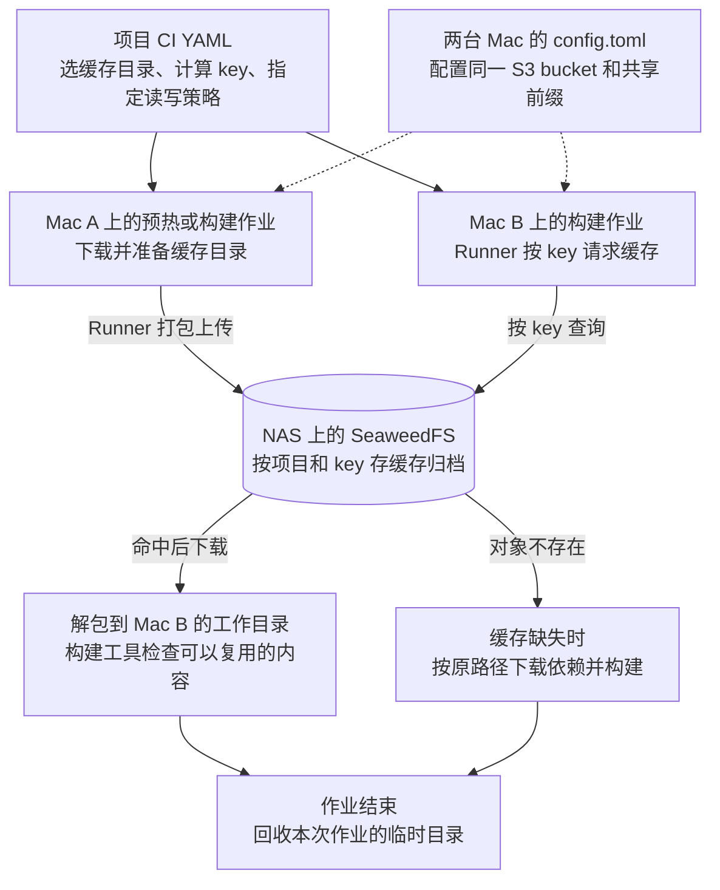

一台负责 iOS 构建的 Mac，只剩不到 **60 GB** 的可用空间。构建缓存越积越多，连定时维护任务都跑不起来了。我们还有另一台 Mac 可以接构建，但两台机器各存一份缓存。作业换台机器跑，有些依赖要重新下载，原本能复用的编译结果也得重新生成。

当时内网刚接入一台 NAS。我们想用它存放能跨机复用的缓存，让两台 Mac 都能取到同一份，同时减少各自长期保留的副本。构建仍在本地执行，所以我们得分别算清本机能少留多少缓存，以及从 NAS 下载、解包之后，一次构建到底能省多久。

## 为什么选 SeaweedFS 和 GitLab Runner

我们先看了 Tuist 的远程缓存。它的缓存节点可以跑在自己的 NAS 上，编译产物也可以留在内网，但节点仍要连接 Tuist 服务端来注册和验证访问权限。接入托管服务端时，生成自托管节点的凭据需要 Enterprise。连服务端也一起部署到内网，则需要单独的付费服务端许可。我们原本想借现有设备搭一套无新增订阅的共享缓存，这项授权要求让我们放弃了 Tuist 方案。[Tuist 自托管缓存文档](https://tuist.dev/en/docs/guides/cache/self-host) · [Tuist 服务端自托管文档](https://tuist.dev/en/docs/guides/server/self-host/server)

最终方案是在 NAS 的 Docker 环境里跑 **SeaweedFS**。它是一个开源存储系统，这里用它提供与 S3 兼容的接口。可以把 S3 理解为一个通过网络按名称存取文件的服务。我们的缓存压缩包就是其中的对象，数据实际落在 NAS 的磁盘上。[SeaweedFS 项目](https://github.com/seaweedfs/seaweedfs) · [S3 对象存储简介](https://docs.aws.amazon.com/AmazonS3/latest/userguide/Welcome.html)

打包、上传和恢复则交给 **GitLab Runner 自带的分布式缓存**。作业结束时，写入端把约定的目录打包上传。下一次作业调度到另一台 Mac，Runner 用相同的缓存键找到压缩包，再解到自己的工作目录。这个方案能沿用现有流水线的 `cache` 配置，构建还是在本机磁盘上进行，也省去了给每台 Mac 配置 SMB 或 NFS 挂载。[GitLab Runner 分布式缓存](https://docs.gitlab.com/runner/configuration/speed_up_job_execution/#use-a-distributed-cache)

连通性验证也要走这条真实路径。试运行时，作业里的 `curl` 已经能收到 S3 的 `403 AccessDenied`，Runner 恢复缓存却仍报 `no route to host`。给 macOS 上的 GitLab Runner 进程授予本地网络权限后，两台机器才都能通过 Runner 的缓存机制下载、解包并校验同一个测试文件。

## 从改配置到跨机命中

这次改动分两处。**Runner 的 `config.toml` 决定缓存发到哪里，项目的 CI YAML 决定哪些目录可以归档、用什么键，以及哪些作业有权写回。** 只改 Runner 配置，流水线还不知道该共享哪些文件。只写 CI 规则，归档也只会留在原有的缓存后端。

在两台 Mac 上，我们按实际运行的 Runner 注册条目修改 `config.toml`。有一台 Mac 同时运行 Shell 和 Docker 两个 executor，两个服务各读自己的配置文件，需要分别核对。下面是去掉地址和凭据后的配置结构。两台 Runner 指向同一个 bucket 和前缀，并设置 `Shared = true`。

```toml
[[runners]]
  # 合入已有 Runner 条目，其余注册配置省略。
  [runners.cache]
    Type = "s3"
    Path = "runner"
    Shared = true

    [runners.cache.s3]
      ServerAddress = "<NAS 的 S3 endpoint>"
      BucketName = "<CI 缓存 bucket>"
      BucketLocation = "us-east-1"
      AuthenticationType = "access-key"
      AccessKey = "<从安全配置注入>"
      SecretKey = "<从安全配置注入>"
```

主工程的 `.gitlab-ci.yml` 引入 `.gitlab/ci/cocoapods-cache.yml`。这份文件用锁文件生成缓存键，列出允许归档的 CocoaPods 下载目录，为读写任务分别设置 `pull` 和 `pull-push`。合并请求和受保护分支分开用键，锁文件变化时才自动预热。KMP 子模块自己的 `.gitlab-ci.yml` 另外声明 Gradle 和 Kotlin/Native 缓存目录，也由 Runner 上传到同一个 S3 后端，归档仍按项目和缓存键隔离。项目 YAML 里只放规则，S3 凭据由 Runner 配置管理。



图中是**已接入的 CocoaPods 和 Gradle 缓存**。作业目录可以随作业结束回收，Runner 留下的 ZIP 与 NAS 对象则分别维护。两类编译产物的改动放在独立入口里。

- **Xcode CAS** 的跨机实验写在 `.gitlab/ci/xcode-cas-nas-experiment.yml`。显式触发后，写入作业把 CAS 快照作为实验归档上传，两个读取作业分别用相同和不同的 checkout 路径验证。正式构建继续用本机 CAS。
- **KMP iOS 链接产物**通过新增的 `scripts/ios-link-cache-s3.py` 直接读写独立 bucket。构建脚本通过 `IOS_LINK_CACHE_BACKEND=s3` 选择这个后端，正式打包目前仍默认使用 Nexus。

## 第一批迁移的是依赖下载

CocoaPods 是 iOS 项目的依赖管理工具。我们缓存的是它下载过的依赖和对应的规格文件，缓存键由 `Podfile.lock` 和 `Gemfile.lock` 决定。锁文件变化会触发预热，负责写入的任务串行执行，普通构建只读。合并请求与受保护分支使用独立的缓存前缀，缺少缓存的作业照常安装依赖。[CocoaPods 安装与锁文件](https://guides.cocoapods.org/using/pod-install-vs-update.html)

第一次跨机验收时，读取任务恰好被调到了写入的同一台 Mac。我们重新调度，用日志里的 Runner ID 确认换了机器。另一台 Mac 花约 **13 秒**下载并解包 **1.03 GiB** 的归档。安装前，用项目的实际安装逻辑确认 **24 个锁定的 Git Pod 全部命中**，随后的 **120 个 Pods** 安装完成，锁文件检查通过。这组结果证明换机后能复用下载过的依赖。安装一共快了多少，还需要同机的冷、热对照。

Kotlin Multiplatform（KMP）模块也通过 GitLab Runner 共享 Gradle 下载和 Kotlin/Native 工具链。另一台 Mac 花约 **28 秒**恢复了 **1.66 GiB** 的归档。看到 `Successfully extracted cache` 后，想继续往下算收益，要看 Gradle 的任务级日志。标记为 `FROM-CACHE` 的任务恢复了已有输出，`UP-TO-DATE` 则说明当前工作目录已有可用输出。我们当时验证到了跨机恢复这一步，尚未测出省了多少 Kotlin 编译。[Gradle Build Cache](https://docs.gradle.org/current/userguide/build_cache.html)

## Xcode 编译缓存搬过去，能用上多少？

Xcode 的 Compilation Cache 会把可复用的编译结果保存在内容寻址存储中，下面简称 CAS。我们把一台 Mac 生成的 CAS 快照交给另一台，再用同一份源码、依赖和工具链做无签名归档。消费端固定在同一台机器，每轮都用新的 DerivedData，也就是 Xcode 保存构建中间产物的目录。两组之间只改了 checkout 的物理路径。[Xcode 26 编译缓存说明](https://developer.apple.com/documentation/xcode-release-notes/xcode-26-release-notes)

下表只统计归档构建阶段，缓存的读写开销另计。

| 消费端 checkout | 空 CAS | 本机热 CAS | NAS 恢复的 CAS |
| --- | ---: | ---: | ---: |
| 与写入端同路径 | 0/2793，363.17 秒 | 2793/2793，66.28 秒 | 2283/2793，294.68 秒 |
| 与写入端不同路径 | 0/2793，361.34 秒 | 2793/2793，71.26 秒 | 1199/2793，362.42 秒 |

不同路径组命中了 1199 项，归档还是花了 362 秒。路径对齐后多命中的 1084 项中，有 1068 项是 Clang 源码编译。两组的 Swift 编译和模块产出仍都是 0/62。这里总命中数涨了多少只是第一层信息，更要紧的是哪些编译任务被省掉了。

同路径组花 **9.73 秒**恢复缓存，写入端另花 **13.93 秒**压缩并上传。假设写入端本来就要归档，从消费端冷构建里扣掉热构建时间和一写一读的开销，约省 **45 秒**。再把两端约 **15 秒**的路径准备算进去，单轮估算净省 **30 秒**。这次无签名归档只测了一轮，顺序固定，同机热缓存又明显更快。因此，正式构建继续使用本机 CAS，NAS 回放留在实验入口里。

这也解释了为什么迁移后还要做本机清理。约 **1.99 GiB** 的 CAS 在试验中额外产生了三份约 **0.88 GiB** 的压缩包，写端、读端和 NAS 各一份。作业结束可以回收解开的目录，Runner 缓存目录里的 ZIP 仍需单独处理。我们验收时分别核对工作目录、Runner 缓存目录和 NAS 上的对象。那台可用空间跌破 60 GB 的机器究竟能长期省下多少磁盘，仍需要看日常构建的峰值和留存数据。

## KMP 的链接缓存为什么另做一个后端

依赖和工具链都准备好之后，Kotlin/Native 还要链接出 iOS framework。一个 XCFramework 可以打包多个目标的二进制，我们把真机和模拟器的那两份分别称为 slice。旧方案把它们存进 Nexus 制品仓库的固定槽位，不同构建算到同一个槽位时，新产物会覆盖旧产物。[Kotlin/Native 编译和链接](https://kotlinlang.org/docs/native-improving-compilation-time.html)

新方案在 NAS 上为每个构建键和 slice 存一个对象，例如 `v1/<build-key>/ios-arm64.tar.gz`。构建键包含源码、锁定的子模块、工具链和构建配置。下载时核对对象里记录的 SHA-256，再解压使用。上传时要求该对象不存在，避免两个作业互相覆盖。真机与模拟器分别判断命中，命中哪一个，就跳过哪一个的链接。预发布 tag 和正式 tag 指向同一提交且键一致时，可以复用二进制，仍分别生成各自版本的 Pod 发布包。

这个后端在隔离的 SeaweedFS 上已验证签名读写、不同键共存和重复上传的保护。代码已合入，正式打包仍默认用 Nexus。切过去前，我们要用真实 NAS 做冷构建、Nexus 命中和 NAS 命中的对照，确认两台 Runner 之间两个 slice 都能命中，再用包括归档传输在内的耗时决定是否启用。

对于也想用 NAS 缓解 Runner 空间压力的团队，建议先挑一类常用的下载缓存做小范围验证。让读取作业换机，核对它取回了哪份归档、构建日志里少了哪些工作，以及作业退出后本机还有几份副本。这样既能知道哪块 SSD 真的能腾出空间，也能判断下一层缓存值不值得过网。
