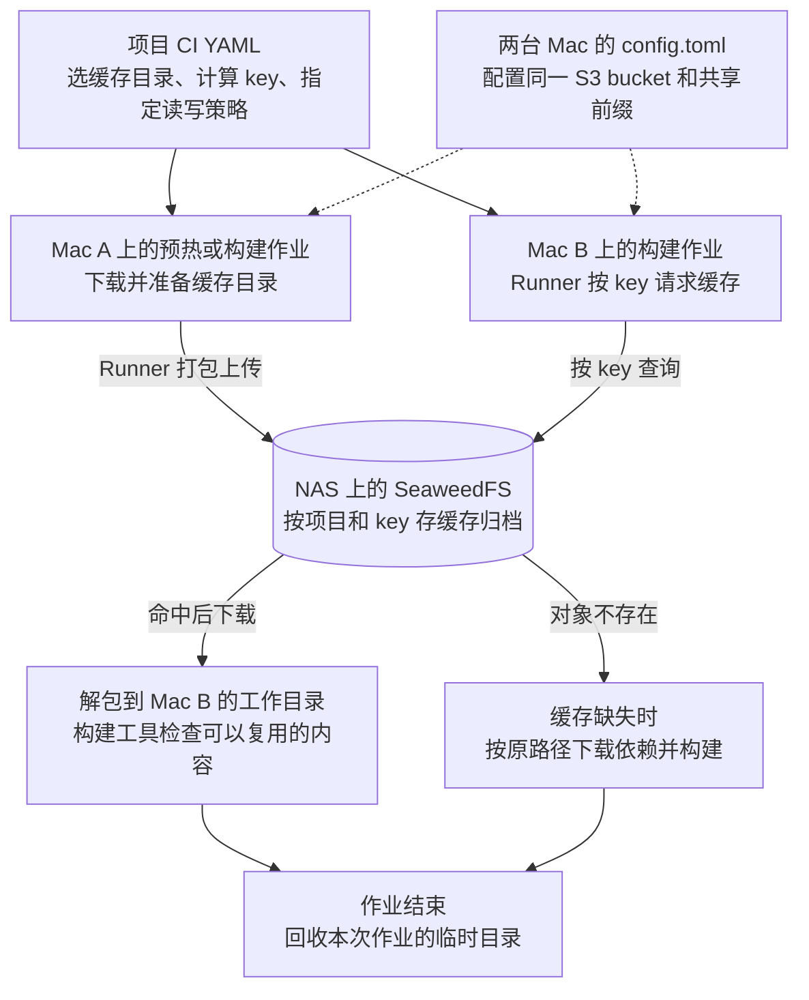

一台跑 iOS 构建的 Mac 可用空间跌到了 **60 GB 以下**。缓存越积越多，定时维护任务都跑不起来了。我们还有另一台 Mac 能接构建，但两台机器的缓存各自存放。任务换台跑，有些依赖要重新下载，能复用的编译结果也可能得再生成一遍。

正好内网接入了一台 NAS。我们想把可共享的缓存留在 NAS 上，让两台 Mac 都能取到，同时少在本机存一些副本。这里有两个问题。把文件取回来要花时间，构建能省回多少？作业仍在本地执行，做完以后又有多少缓存留在磁盘上？

## 缓存里到底装了什么

我们的 App 有一个 Swift 和 Objective-C 的原生 iOS 宿主，部分页面用 React Native，另有 Kotlin Multiplatform（KMP）模块供 iOS 和 Android 共享代码。宿主通过 CocoaPods 集成原生依赖、React Native 的 iOS 运行时，以及 KMP 发布的二进制 Pod，然后用 Xcode 编译和归档。KMP 有自己的发布流水线。Gradle 准备依赖和工具链，Kotlin/Native 分别为真机和模拟器产出 framework，再把它们装进同一个 XCFramework 交给宿主。日常 App 构建直接消费已经发布的 Pod。

这次要判断的是四类缓存。CocoaPods 和 Gradle 的目录可以先整体恢复，里面既有下载过的依赖，也可能有任务输出。等轮到 **Xcode 编译缓存**和 **KMP 链接缓存**，光把文件搬过去就不够了。构建工具还要判断这份产物是否匹配当下的输入。迁移于是从最容易确认的一层开始。让另一台 Mac 用上已经下载的文件，再去测它能不能少做一次编译或链接。

## 归档怎么从一台 Mac 到另一台

我们看过 Tuist 的远程缓存。它允许把缓存节点放在自己的 NAS 上，但仍需要 Tuist 服务端来注册节点和验证访问权限。使用托管服务端，生成自托管节点凭据需要 Enterprise。连服务端也放进内网，则需要单独的付费许可。我们打算利用已有设备，避免新增订阅，因此没有采用这条路线。[Tuist 自托管缓存](https://tuist.dev/en/docs/guides/cache/self-host) · [Tuist 服务端许可](https://tuist.dev/en/docs/guides/server/self-host/server)

最终是在 NAS 上用 Docker 运行开源存储系统 **SeaweedFS**，提供兼容 S3 的接口。S3 可以理解为通过网络按名称存取文件，归档作为对象保存，数据落在 NAS 磁盘上。GitLab Runner 已经支持用 S3 做分布式缓存，构建仍在本机工作目录里执行，两台 Mac 无需挂载 SMB 或 NFS 共享目录。[SeaweedFS 项目](https://github.com/seaweedfs/seaweedfs) · [S3 对象存储简介](https://docs.aws.amazon.com/AmazonS3/latest/userguide/Welcome.html)

接入要改两处。**Runner 的 `config.toml` 决定归档发到哪里。项目的 `.gitlab-ci.yml` 决定归档里放什么、键是怎么来的，以及谁可以回写。** 两台 Mac 指向同一个 bucket 和共享前缀。一台 Mac 同时有 Shell 和 Docker 两套 Runner 服务，我们也分别检查了它们实际读取的配置文件。下面省略了注册信息和真实凭据。[GitLab Runner 分布式缓存](https://docs.gitlab.com/runner/configuration/speed_up_job_execution/#use-a-distributed-cache)

```toml
[[runners]]
  # 合入已有 Runner 条目，其余注册配置省略。
  [runners.cache]
    Type = "s3"
    Path = "runner"
    Shared = true

    [runners.cache.s3]
      ServerAddress = "<NAS 的 S3 endpoint>"
      BucketName = "<CI 缓存 bucket>"
      BucketLocation = "us-east-1"
      AuthenticationType = "access-key"
      AccessKey = "<从安全配置注入>"
      SecretKey = "<从安全配置注入>"
```

CI 规则把需要保留的目录列出来。CocoaPods 用锁文件给归档分组，Gradle 用 Wrapper 配置和依赖版本表分组。读任务用 `pull`，可回写的任务用 `pull-push`。Runner 会在作业开始时用键查找并解包归档，允许写回的作业结束后再上传。对象仍按项目和缓存键隔离。[GitLab CI 缓存机制](https://docs.gitlab.com/ci/caching/)



验证这条路径时，我们踩过一个容易漏掉的坑。作业里的 `curl` 能收到 S3 的 `403 AccessDenied`，Runner 自己去恢复缓存却报 `no route to host`。给 macOS 上的 GitLab Runner 进程授予本地网络权限后，两端才都能通过正式的缓存机制下载、解包并校验同一个测试文件。到这里确认的是归档能跨机搬运，接下来才看构建能用上什么。

## 先从重复下载下手

### CocoaPods 可以直接使用下载过的依赖

CocoaPods 根据锁文件确定版本，再查本地是否已经下载过对应依赖。我们把下载目录和规格文件（podspec）放进归档，用 `Podfile.lock` 和 `Gemfile.lock` 生成键。合并请求与受保护分支使用不同前缀，锁文件变化时由串行的预热任务写入。另一台 Mac 恢复缓存后，`pod install` 仍会照常安装和集成依赖，省掉的是命中条目的下载。[CocoaPods 安装与锁文件](https://guides.cocoapods.org/using/pod-install-vs-update.html)

首次验证的读写任务被调到了同一台 Mac。重新调度后，我们用 Runner ID 确认两端是不同机器。读取端花约 **13 秒**下载并解包 **1.03 GiB** 的归档。按项目实际的安装逻辑检查，**24 个锁定的 Git Pod 全部命中**，随后安装完 **120 个 Pods**，锁文件也通过检查。这已经能说明跨机复用确实发生了。至于安装总共快了多少，还缺消费端同机的冷、热对照。

### Gradle 恢复目录以后，还要逐个判断任务

KMP 流水线搬的是 Gradle 依赖、Wrapper 下载的 Gradle 发行包，以及 Kotlin/Native 工具链目录。另一台 Mac 花约 **28 秒**恢复了 **1.66 GiB** 的归档，日志中能看到 `Successfully extracted cache`。它能说明归档已解到本地，下一条要查的日志来自 Gradle。

对支持缓存的任务，Gradle Build Cache 会根据任务实现和声明的输入计算键。比如编译任务的输入可以包括源码、编译选项和依赖。找到了相同键的结果，就直接用以前的输出，标为 `FROM-CACHE`。`UP-TO-DATE` 则表示当前工作目录已经有可用结果。这次是用 GitLab 归档搬运 Gradle 的本地缓存，具体输出依然由 Gradle 查找。跨机恢复已有证据，Kotlin 编译任务省下了多少工作仍待测量。[Gradle Build Cache](https://docs.gradle.org/current/userguide/build_cache.html)

## 再看能不能少做编译或链接

下载缓存恢复后，安装和编译仍继续。要跳过编译或链接，取回来的得是已经算好的结果，而且当前构建愿意接受它。Xcode 和 KMP 在这一步用的判断粒度不同。

### Xcode CAS，命中率要和归档耗时一起看

Xcode 的 Compilation Cache 会给一次编译动作的输入算出指纹，再把编译结果放到内容寻址存储（CAS）中。同样的动作再次出现时，可以取回对应的目标文件或模块。把 CAS 快照搬到另一台 Mac 后，编译器仍以这台机器的有效输入查找匹配项。[Xcode 26 编译缓存说明](https://developer.apple.com/documentation/Xcode-Release-Notes/xcode-26-release-notes?changes=la_5__7_1)

我们在同一台消费 Mac 上恢复同一份快照，固定源码、依赖和工具链，每轮使用新的 DerivedData，也就是 Xcode 存放构建中间产物的目录。两组的区别是源码 checkout 的物理路径。下表记录无签名归档阶段的耗时，缓存读写另计。

| 消费端 checkout | 空 CAS | 本机热 CAS | NAS 恢复的 CAS |
| --- | ---: | ---: | ---: |
| 与写入端同路径 | 0/2793，363.17 秒 | 2793/2793，66.28 秒 | 2283/2793，294.68 秒 |
| 与写入端不同路径 | 0/2793，361.34 秒 | 2793/2793，71.26 秒 | 1199/2793，362.42 秒 |

不同路径组虽然命中了 **1199 项**，归档还是花了 **362 秒**。路径对齐后多命中的 **1084 项**里，有 **1068 项**是 Clang 源码编译。两组的 Swift 编译和模块产出均为 **0/62**。同一份归档搬得过去，能换回多少时间，还得看究竟是哪一批任务命中。

同路径组恢复耗时 **9.73 秒**，写入端另花 **13.93 秒**压缩并上传。假设写入端本来就要归档，一写一读比消费端冷构建约省 **45 秒**。再扣掉两端约 **15 秒**的路径准备，单轮估算净省 **30 秒**。这个结果来自固定顺序的一次无签名归档对照。相比之下，本机热缓存只用了约一分钟，所以日常构建继续用本机 CAS，跨机回放放在实验入口里。

### KMP 链接缓存，从固定槽位改成按键存放

KMP 要交付的是 XCFramework，其中真机和模拟器对应的两份二进制各称为一个 slice。我们原先就把已经链接好的 slice 放进 Nexus 制品仓库。每次构建先计算键，再取键的部分哈希值对 **50** 取余，决定去哪个槽位查找。两个 slice 的归档分别保存在同一槽位下，并各有小文件记录完整键和 SHA-256。[Kotlin/Native 编译和链接](https://kotlinlang.org/docs/native-improving-compilation-time.html)

如果提交 A 和提交 B 都落在 12 号槽，B 后写的真机归档就会覆盖 A 的。再打包 A 时，虽然看见槽位里有文件，完整键也会告诉我们该文件属于 B，A 只能重新链接。固定槽位控制了归档的留存规模，同时也可能把很快就要复用的产物提前挤掉。

换到 NAS 后，完整构建键和目标平台成为对象名的一部分，例如 `v1/<build-key>/ios-arm64.tar.gz`。A 和 B 可以并存。构建流程会在链接前按提交、锁定的子模块、工具链和构建模式算出键，分别寻找两个 slice。找到的归档经 SHA-256 校验后直接用于打包，缺哪份才链接哪份，新归档只在同名对象不存在时上传。预发布 tag 和正式 tag 若指向同一提交且键一致，能够共享 framework，再各自生成带版本号的 Pod 发布包。启用后，对象按留存规则过期，容量按写入量和单对象大小管理。

隔离的 SeaweedFS 已验证签名读写、不同键共存和重复上传保护。代码已合入，正式打包仍默认使用 Nexus。切换前要在真实 NAS 上对比冷构建、Nexus 命中和 NAS 命中。确认不同 Runner 之间两个 slice 都能命中，再把传输算进构建耗时。

## NAS 有了缓存，本机还会留下什么

磁盘这一笔很容易漏算。Xcode 实验里的原始 CAS 约 **1.99 GiB**。为跨机复用生成的归档约 **0.88 GiB**，在写入端、读取端和 NAS 各出现了一份。作业结束可以清理展开的工作目录，Runner 缓存目录里的 ZIP 和 NAS 上的对象却要分别维护。实验收尾时，我们按这三处逐一核对。日常作业的峰值和长期留存还要另测，才能回答当初那台 Mac 究竟腾出了多少空间。

如果从头做一次，我仍会先挑一种能凭锁文件识别的下载缓存。让读的任务换台机器跑，先确认它取回的是哪份归档、实际少做了什么，最后看退出后本机还有几份副本。这三个观察结果，比一条缓存恢复成功的日志更能说明下一类缓存值不值得迁移。
