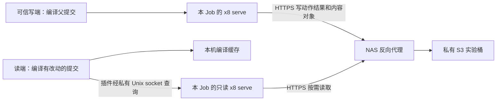

一处 Swift 改动合并前要交付签名 IPA。如果下一次构建被调度到另一台 Mac，它能从上一台机器复用多少编译工作？我们已经有每机持久化的 Xcode 编译缓存，也能在冷启动时从 NAS 恢复快照。引入 x8 的动机来自一个更具体的场景：消费机本地已有部分对象，能否只取缺的部分，让开发者更早拿到 IPA？

截至 2026-11-27，新候选版已经在真实对象存储上完成完整 App 的签名写入，另一台 Mac 也从这批对象里读出了编译结果。旧版本跑过完整 App 的读端试验，观察到远端命中，也观察到更长的交付时间。候选版的完整读端对照还要等两台正式实验机重新对齐工具链；日常 MR 的 x8 灰度仍未开启。

## 为什么选 Xcode 27

Xcode 26 已经为 Swift 和 C 系语言引入了可选的编译缓存。开启 `Enable Compilation Caching` 后，切回旧分支，或清理 DerivedData 后重新构建，只要本机编译缓存还在、编译输入一致，编译器就能取回上次的结果。我们此前在 Xcode 26.5 上做过跨机快照实验：把一台 Mac 的缓存整体搬到另一台，再从恢复好的本机缓存构建。这给了本轮实验一个可比较的起点。[Apple 的 Xcode 26 发布说明](https://developer.apple.com/documentation/xcode-release-notes/xcode-26-release-notes) · [跨机快照实验](../xcode-cas-cross-machine-replay/)

**27 对这个实验最有用的变化，是 Swift 和 Clang 都有了项目级路径前缀映射。** 假设同一份 `Parser.swift` 在写端位于 `/build/a/App/Sources/`，在读端位于 `/build/b/App/Sources/`。源文件的字节相同，编译器看到的绝对路径却不同。路径参与依赖扫描和编译动作的键计算；一旦动作键不同，即使 NAS 上存着可复用的结果，读端也找不到它。

我们直接对照了 Xcode 26.6 和 27.2 随包的 `Swift.xcspec`、`Clang.xcspec`。两版都有通用前缀映射；27.2 还定义了 `SWIFT_ENABLE_PROJECT_PREFIX_MAPPING` 和 `CLANG_ENABLE_PROJECT_PREFIX_MAPPING`。开启后，编译器扫描时会把项目根目录、项目临时目录、构建产物目录分别映射到 `/^src`、`/^derived`、`/^built`。上例的两个 checkout 因而可以用同一个逻辑路径 `/^src/Sources/Parser.swift` 描述这个输入。工具链、SDK、编译参数和生成文件仍会影响动作键。我们在原生组和 x8 组都启用相同映射，才能单独测量接入远端存储的影响。[x8 0.1.0 的路径映射说明](https://github.com/Ryu0118/x8/blob/0.1.0/Sources/X8CLI/X8CLI.docc/PrefixMapping.md)

本轮还有一个直接的版本约束：**x8 0.1.0 官方可执行文件要求 Xcode 27 或更高版本。** 我们选择具体的 27.2，是为了让两台 Mac 用同一 Xcode build 和 SDK 重放同一份输入。一台机器回退到 26.6 后，它仍能做原生缓存构建，但已不符合这组 x8 对照的条件。[x8 0.1.0 的运行要求](https://github.com/Ryu0118/x8/blob/0.1.0/README.md#installation)

## x8 是什么，一次远端命中怎样发生

x8 是一个开源的 **Xcode 远端编译缓存代理**。Xcode 负责计算编译动作的键、决定要复用哪些结果，以及在未命中时调用编译器。每台 Mac 上的 x8 负责把 Xcode 的缓存查询和对象读写转给同一个 S3 兼容存储。这里的 CAS（Content-Addressable Storage，内容寻址存储）用内容标识引用编译结果对象。NAS 只需保存这些记录和对象；编译、链接和 IPA 签名都在 Runner 上执行。[x8 0.1.0 的架构图与协议说明](https://github.com/Ryu0118/x8/blob/0.1.0/README.md#how-it-works)

以改动一个 Swift 文件的 MR 为例：

1. **写端预热父提交。** Xcode 编译父提交，x8 把可缓存动作的结果记录和引用的内容对象写入 S3。记录回答“这个动作以前产出了什么”，对象才是复用时需要取回的数据。
2. **读端查询未改动的模块。** 换一台 Mac 构建 MR 时，如果本机还缺该结果，Xcode 插件经私有 Unix socket 向本机 x8 查询动作键。找到远端记录后，插件再请求它引用的对象。两步分别能看到 `kv.getValue/hit` 和 `cas.load/hit`；对象取回后，编译器可以跳过这次编译。一次动作可引用多个对象，因此下文热构建的 4 次动作命中对应 10 次对象读取。
3. **读端编译有变化的输入。** 改过的文件或受影响的依赖会产生新的动作键。远端查不到时，Xcode 在读端实际编译，再与复用的结果一起完成后续构建。旧 NAS 快照方案在冷启动时恢复整份归档；x8 允许一台已有部分本机缓存的 Mac 按对象补齐。少编译的时间能否抵过网络查询和下载，正是签名 IPA 对照要测的量。

两边的 Runner 都按 Job 启停前台代理。Xcode 通过 `COMPILATION_CACHE_REMOTE_SERVICE_PATH` 连接当前作业的 `cache.sock`。对这个实例发一次 gRPC 查询，用随机键收到预期的未命中，再开始统计编译事件。NAS 用 HTTPS 反代把请求转给 S3 服务；写身份只在可信源码的预热作业中使用，消费侧的 x8 配置和存储授权都限制为只读。实现可从 [x8 上游项目](https://github.com/Ryu0118/x8) 和[本地 socket 握手笔记](../x8-010-cache-socket-grpc/) 对照阅读。

## 如何组织一次能比较的实验

1. **固定三个代码状态。** S 是较早的已合入版本，P 是写端预热的父提交，M 在 P 上只改一处参与编译的 Swift 输入。固定依赖锁、子模块、Xcode 与 SDK 的 build 号、构建路径映射、签名身份和构建号。每轮只更换预先选定的那一个自变量。
2. **先在两台机器跑小工程。** 新一轮用独立空桶，写端留下本轮 owner 标记。读端从空的本机 CAS 对相同输入重建，再有意修改一个输入重建。分别保留 Xcode 的 hit/miss、代理事件、返回码及读身份 PUT 被拒的证据。同一轮重试沿用 owner；单独的历史只读回放要固定源批次。桶的准备与恢复见[实验桶归属记录](../x8-cas-s3-pipeline-bucket-owner/)。
3. **对照真正签名的 App。** 写端构建 P。读端先用 S 生成“部分热”本机种子，再用 M 生成“本机已热”种子。每一对中，原生组和 x8 组各从同一个种子恢复到相同绝对路径，用新 DerivedData 构建同一个 M。保留既有的依赖准备、归档、签名、导出和上传步骤。
4. **把计时终点设在开发者拿到产物的位置。** 从该 Job 开始计时，到制品仓完整回读 IPA 且 SHA-256 一致。分列依赖准备、归档、导出、制品传输和排队时间；串行重放还要分清第二组等待第一组的时间。写端的预热成本另记。每个场景先跑一对 pilot，检查制品，再做四对正式样本，交替安排原生与 x8 的先后。正式样本有同机其他构建、输入有漂移或缺签名证据时保留记录并补测。

## x8 写端的代理崩溃与 S3 上传超时

### 代理崩溃：x8 依赖的 AsyncHTTPClient 提前释放了请求

第一批写端日志反复出现 `Connection refused (errno: 61)`。这条连接的目标是 Runner 上的 Unix socket。排障时先对齐代理退出时间、崩溃位置和下游第一次拒连的时间，再检查对象存储。仅凭编译器打印的“CAS error”无法确定 NAS 断网。

我们在内部 fork 回移了 AsyncHTTPClient 1.36.1 的 HTTP/2 请求生命周期补丁。上游给出的触发顺序很具体：服务器在请求体发送完成前先结束成功响应，状态机给出 `.none`，后面还会继续处理请求体。旧 handler 提前清空 `self.request`，通道恢复可写或流失败时可能解包空引用。补丁让 handler 在 `.none` 时保留请求，在 `.close` 或 `.requestDone` 时释放。对应回归用例补丁前失败，补丁后相关 11 项测试通过。这解释了一个能够使代理退出的缺陷；后续每一次拒连仍需用该次进程或 socket 证据定位。[上游修复与触发条件](https://github.com/swift-server/async-http-client/pull/942)

为保证两个 Runner 得到同一补丁，我们按 `Package.resolved` 打包锁定提交的 Git 镜像，在干净 CI 作业中重建 SwiftPM 的 editable checkout 并应用补丁。CI 测默认与 S3 两种配置，打双架构归档；消费作业从内网包仓下载，解包前检查固定摘要。这使一次缓存故障的调查可以精确到“实际运行的二进制”。[SwiftPM 锁定镜像与补丁验证](../swiftpm-locked-git-mirrors/)

### S3 上传超时：已复现触发条件，现场根因仍未确定

这次 x8 代理一直在处理请求，签名 IPA 也成功交付。异常发生在 x8 向 S3 上传对象的阶段。写端有 743 次 `cas.save/remoteError`，其中观察到 `HTTPClientError.deadlineExceeded`。同一时间窗内，SeaweedFS 记录了 552 次入站 PUT 请求体提前结束（`unexpected EOF`），其中 496 次收到 0 字节，56 次只收到部分数据。这 552 次按底层读取错误计数，外层 PUT handler 还会为同一错误再记一条。客户端、反代和存储端缺少能对应到同一请求的时间线，因此无法确定哪一端先中止传输，也无法把 743 和 552 逐项对应。

为验证传输协议是否影响复现，我们用相同的 S3 客户端发送 256 个不同对象，并发 64，共享限速 8 MiB/s。自动协商到 HTTP/2 的一轮有 12 次请求超时；写端固定 HTTP/1.1 后，256 个对象全部通过内容校验。另一次在本地 TLS 反代后接同版本 SeaweedFS，取消限速后，两种协议都完整写入了 256 个对象。这组对照说明在给定负载和限速下切换协议能避开超时，尚不能把现场故障归因于 HTTP/2 本身或某个组件。

据此，x8 fork 给签名 S3 写端增加可选配置 `s3.api.httpVersion: http1Only`；读端继续自动协商，Xcode 到本机 socket 的 gRPC 继续使用 HTTP/2。候选包在真实 NAS 上完成了一次签名构建，写端记录 7,350 次内容保存、5,323 次动作结果写入，完整事件流中没有写入 RPC 错误。**目前验证的是写端规避措施有效，现场超时的具体根因仍未定位。** 若再次出现，需要对齐同一个 PUT 在客户端的截止时间、反代的上下游传输记录和存储端的读入结果，才能判断谁先中止。[传输对照与存储端取证](../x8-010-cache-socket-grpc/)

读端还有一个容易混淆的计数：当配置为只读，Xcode 要保存刚在本机编译的对象时，x8 也可能记一条 `cas.save/remoteError`。旧 pilot 中有 3,004 次此类拒写，传输字节为零，同时有 4,287 次对象读取命中。判断服务质量时应同时看角色、RPC、结果和字节数。

## 已验证的结果和仍缺的数据

| 观测范围 | 原始结果 | 证据能回答的问题 |
|---|---|---|
| 旧版完整 App，部分热 pilot | 原生 423.95 秒，x8 528.92 秒；两组均交付签名 IPA | 这一对中 x8 慢约 105 秒，读端确有对象命中 |
| 旧版完整 App，本机热 pilot | 原生 328.02 秒，x8 443.37 秒；两组均交付签名 IPA | 这一对中 x8 慢约 115 秒。两个场景各只有一对，四次运行都检测到同机还有其他 Xcode 构建，且写端当轮有传输错误 |
| HTTP/1.1 候选，实际 NAS 写端 | 完整签名 IPA 交付；代理记录 7,350 次内容保存、5,323 次动作结果写入，未记录写入 RPC 错误 | 此次生产者能把对象写完。这里计的是代理 RPC，线上 S3 请求和字节应另取存储侧记录 |
| 同候选，另一台 Mac 的只读小工程 | 热构建 4 hit / 0 miss、10 次远端对象读取；改变一个输入后 3 hit / 1 miss，两次都成功 | 同一批对象可以跨机复用，缺的输入可以本地重编；完整 App 的读端时间仍待测 |

临时消费机上，终端访问 HTTPS 成功，CI 进程却报 `Local network prohibited`。核对实际承接作业的 Runner 进程和 macOS 的本地网络授权后，真实 smoke 才通过。其后完整 App 的原生 seed 又停在 WWDR 证书安装，后继对照没有产生。正式消费机在此期间发生 Xcode 版本漂移，这些运行在台账中分别归到环境或签名前置条件。[macOS Runner 本地网络授权排查](../gitlab-macos-cache-helper-local-network/)

### 工具链恢复后怎样补数

在正式消费机上先核对 Xcode **27.2（27B52）** 和 iPhoneOS SDK **24B8118**，从新批次空桶重跑同一版本。以下保留正式样本的记录位置，旧 pilot 不计入这张表。

| 场景 | 有效对数 | 原生 / x8 每对 Job 至 IPA（秒） | 配对节省中位数（秒 / %） | 远端读取与签名证据 |
|---|---:|---|---|---|
| 换机、部分热 | 待测 / 4 | 待补四对 | 待补 | 待补 |
| 本机已热 | 待测 / 4 | 待补四对 | 待补 | 待补 |

预定的部分热门槛是至少三对变快，配对节省中位数达到 20 秒，配对节省百分比的中位数达到 5%；本机热的中位退化最多 5 秒。还要分别记录缺对象、启动前存储不可达、构建中断连三种情况下的签名 IPA 交付，并保留写端额外耗时。即使一对构建明显变快，团队是否获益仍取决于平常有多少次跨机读取能摊薄一次预热。只有小范围真实 MR 才能量到从开发者推送到 IPA 可下载的实际等待分布。
