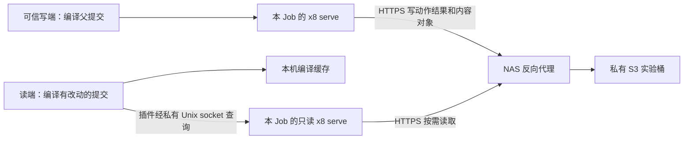

一处 Swift 改动合并前要交付签名 IPA。如果下一次构建被调度到另一台 Mac，它能从上一台机器复用多少编译工作？我们已经有每机持久化的 Xcode 编译缓存，也能在冷启动时从 NAS 恢复快照。引入 x8 的动机来自一个更具体的场景：消费机本地已有部分对象，能否只取缺的部分，让开发者更早拿到 IPA？

截至 2026-11-27，新候选版已经在真实对象存储上完成完整 App 的签名写入，另一台 Mac 也从这批对象里读出了编译结果。旧版本跑过完整 App 的读端试验，观察到远端命中，也观察到更长的交付时间。候选版的完整读端对照还要等两台正式实验机重新对齐工具链；日常 MR 的 x8 灰度仍未开启。

## 一个命中怎样变成一次编译复用

一次可缓存的编译动作有两个问题要回答。先用动作的键查找此前的结果，再取回该结果引用的内容对象。x8 的事件里分别能看到 `kv.getValue/hit` 和 `cas.load/hit`。一个动作可以引用多个对象，所以四次动作命中可以伴随十次对象读取。只数请求量，很难判断编译器究竟跳过了哪些工作。

两边的 Runner 都按 Job 启停前台代理。Xcode 通过 `COMPILATION_CACHE_REMOTE_SERVICE_PATH` 连接当前作业的 `cache.sock`。对这个实例发一次 gRPC 查询，用随机键收到预期的未命中，再开始统计编译事件。NAS 用 HTTPS 反代把请求转给 S3 服务；写身份只在可信源码的预热作业中使用，消费侧的 x8 配置和存储授权都限制为只读。实现可从 [x8 上游项目](https://github.com/Ryu0118/x8) 和[本地 socket 握手笔记](../x8-010-cache-socket-grpc/) 对照阅读。

## 如何组织一次能比较的实验

1. **固定三个代码状态。** S 是较早的已合入版本，P 是写端预热的父提交，M 在 P 上只改一处参与编译的 Swift 输入。固定依赖锁、子模块、Xcode 与 SDK 的 build 号、构建路径映射、签名身份和构建号。每轮只更换预先选定的那一个自变量。
2. **先在两台机器跑小工程。** 新一轮用独立空桶，写端留下本轮 owner 标记。读端从空的本机 CAS 对相同输入重建，再有意修改一个输入重建。分别保留 Xcode 的 hit/miss、代理事件、返回码及读身份 PUT 被拒的证据。同一轮重试沿用 owner；单独的历史只读回放要固定源批次。桶的准备与恢复见[实验桶归属记录](../x8-cas-s3-pipeline-bucket-owner/)。
3. **对照真正签名的 App。** 写端构建 P。读端先用 S 生成“部分热”本机种子，再用 M 生成“本机已热”种子。每一对中，原生组和 x8 组各从同一个种子恢复到相同绝对路径，用新 DerivedData 构建同一个 M。保留既有的依赖准备、归档、签名、导出和上传步骤。
4. **把计时终点设在开发者拿到产物的位置。** 从该 Job 开始计时，到制品仓完整回读 IPA 且 SHA-256 一致。分列依赖准备、归档、导出、制品传输和排队时间；串行重放还要分清第二组等待第一组的时间。写端的预热成本另记。每个场景先跑一对 pilot，检查制品，再做四对正式样本，交替安排原生与 x8 的先后。正式样本有同机其他构建、输入有漂移或缺签名证据时保留记录并补测。

## 两次故障为什么用了两种改法

### 第一次：本机 socket 拒绝连接，先查代理的生命周期

第一批写端日志反复出现 `Connection refused (errno: 61)`。这条连接的目标是 Runner 上的 Unix socket。排障时先对齐代理退出时间、崩溃位置和下游第一次拒连的时间，再检查对象存储。仅凭编译器打印的“CAS error”无法确定 NAS 断网。

我们在内部 fork 回移了 AsyncHTTPClient 1.36.1 的 HTTP/2 请求生命周期补丁。上游给出的触发顺序很具体：服务器在请求体发送完成前先结束成功响应，状态机给出 `.none`，后面还会继续处理请求体。旧 handler 提前清空 `self.request`，通道恢复可写或流失败时可能解包空引用。补丁让 handler 在 `.none` 时保留请求，在 `.close` 或 `.requestDone` 时释放。对应回归用例补丁前失败，补丁后相关 11 项测试通过。这解释了一个能够使代理退出的缺陷；后续每一次拒连仍需用该次进程或 socket 证据定位。[上游修复与触发条件](https://github.com/swift-server/async-http-client/pull/942)

为保证两个 Runner 得到同一补丁，我们按 `Package.resolved` 打包锁定提交的 Git 镜像，在干净 CI 作业中重建 SwiftPM 的 editable checkout 并应用补丁。CI 测默认与 S3 两种配置，打双架构归档；消费作业从内网包仓下载，解包前检查固定摘要。这使一次缓存故障的调查可以精确到“实际运行的二进制”。[SwiftPM 锁定镜像与补丁验证](../swiftpm-locked-git-mirrors/)

### 第二次：代理仍在运行，高并发写入出现请求超时

后续一轮成功交付了签名 IPA，写端却同时报告 743 次 `cas.save/remoteError`。同一 UTC 窗口里，SeaweedFS 在读取入站 PUT 请求体时记录了 552 次 `unexpected EOF`。其中 496 次收到 0 字节，56 次只收到部分数据。底层读取函数和外层 PUT handler 各打印一条，按底层事件统计才能避免翻倍。两侧没有逐请求关联，无法把 743 和 552 一一对应，也无法从 EOF 判断哪一端先断。

我们用相同 S3 客户端发送 256 个不同对象，并发 64，共享限速 8 MiB/s。自动协商到 HTTP/2 的一轮有 12 次超时；签名 S3 写端限定 HTTP/1.1 后 256 次写入全部通过内容校验。候选版增加 `s3.api.httpVersion: http1Only`，只在 writer 上启用。reader 仍自动协商，Xcode 到 socket 的 gRPC 仍是 HTTP/2。这个改动已随候选包跑过实际 NAS，fork 中仍处于待合并状态。限速实验和真实写端的结果支持这项缓解措施，尚不足以把所有超时归因于反代、存储或网络中的某一处。

读端还有一个容易混淆的计数：当配置为只读，Xcode 要保存刚在本机编译的对象时，x8 也可能记一条 `cas.save/remoteError`。旧 pilot 中有 3,004 次此类拒写，传输字节为零，同时有 4,287 次对象读取命中。判断服务质量时应同时看角色、RPC、结果和字节数。

## 已验证的结果和仍缺的数据

| 观测范围 | 原始结果 | 证据能回答的问题 |
|---|---|---|
| 旧版完整 App，部分热 pilot | 原生 423.95 秒，x8 528.92 秒；两组均交付签名 IPA | 这一对中 x8 慢约 105 秒，读端确有对象命中 |
| 旧版完整 App，本机热 pilot | 原生 328.02 秒，x8 443.37 秒；两组均交付签名 IPA | 这一对中 x8 慢约 115 秒。两个场景各只有一对，四次运行都检测到同机还有其他 Xcode 构建，且写端当轮有传输错误 |
| HTTP/1.1 候选，实际 NAS 写端 | 完整签名 IPA 交付；代理记录 7,350 次内容保存、5,323 次动作结果写入，未记录写入 RPC 错误 | 此次生产者能把对象写完。这里计的是代理 RPC，线上 S3 请求和字节应另取存储侧记录 |
| 同候选，另一台 Mac 的只读小工程 | 热构建 4 hit / 0 miss、10 次远端对象读取；改变一个输入后 3 hit / 1 miss，两次都成功 | 同一批对象可以跨机复用，缺的输入可以本地重编；完整 App 的读端时间仍待测 |

临时消费机上，终端访问 HTTPS 成功，CI 进程却报 `Local network prohibited`。核对实际承接作业的 Runner 进程和 macOS 的本地网络授权后，真实 smoke 才通过。其后完整 App 的原生 seed 又停在 WWDR 证书安装，后继对照没有产生。正式消费机在此期间发生 Xcode 版本漂移，这些运行在台账中分别归到环境或签名前置条件。[macOS Runner 本地网络授权排查](../gitlab-macos-cache-helper-local-network/)

### 工具链恢复后怎样补数

在正式消费机上先核对 Xcode **27.2（27B52）** 和 iPhoneOS SDK **24B8118**，从新批次空桶重跑同一版本。以下保留正式样本的记录位置，旧 pilot 不计入这张表。

| 场景 | 有效对数 | 原生 / x8 每对 Job 至 IPA（秒） | 配对节省中位数（秒 / %） | 远端读取与签名证据 |
|---|---:|---|---|---|
| 换机、部分热 | 待测 / 4 | 待补四对 | 待补 | 待补 |
| 本机已热 | 待测 / 4 | 待补四对 | 待补 | 待补 |

预定的部分热门槛是至少三对变快，配对节省中位数达到 20 秒，配对节省百分比的中位数达到 5%；本机热的中位退化最多 5 秒。还要分别记录缺对象、启动前存储不可达、构建中断连三种情况下的签名 IPA 交付，并保留写端额外耗时。即使一对构建明显变快，团队是否获益仍取决于平常有多少次跨机读取能摊薄一次预热。只有小范围真实 MR 才能量到从开发者推送到 IPA 可下载的实际等待分布。
