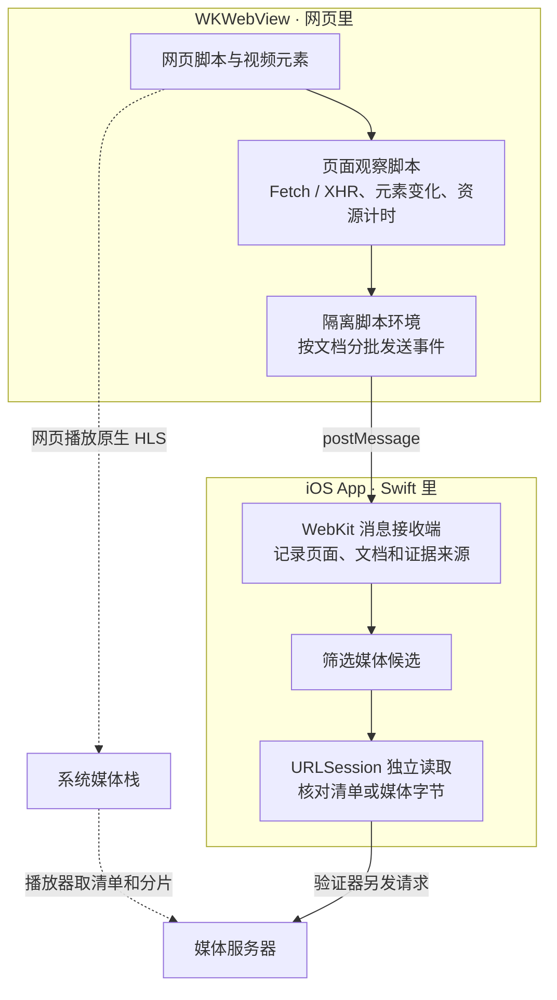

在 iPhone 模拟器里打开苹果的 [Advanced Stream HEVC 样例](https://developer.apple.com/streaming/examples/advanced-stream-hevc.html)，点播放。画面在动，播放时间也在走，我们写的嗅探器却报告：**清单响应 0 条**。视频明明在播，请求去哪儿了？

要回答它，先看嗅探器装在哪儿。我们在一个个人项目 CrawlerBot 里，让 `WKWebView` 打开网页，在**网页脚本能看见的地方**记录资源线索，再让 Swift 判断哪条线索值得发起一次独立请求。它替代了桌面上原本用 Puppeteer、Playwright 做的部分工作：等页面运行、找出资源、交给下载器。普通 Example 的这条路径只用公开 API。我们也试过往更低层接管 HTTP 请求，下文会讲具体用了什么，以及为什么没有把那个原型并进来。

## 一条媒体地址怎样从网页走到 Swift？

图里有两种箭头：实线连起嗅探和验证的步骤；虚线是**网页点播放之后，系统媒体栈自己走的路**。两边可以访问同一台服务器，却不是同一次请求。



**先把脚本放对位置。** 创建 WebView 之前，我们把 `WKUserScript` 加入配置，同时覆盖主文档和嵌套的子页面（frame）。假设 `observerSource` 是观察脚本的源码，决定它能否看见网页调用的，是下面这几行：

```swift
let config = WKWebViewConfiguration()
let observer = WKUserScript(source: observerSource,
                            injectionTime: .atDocumentStart,
                            forMainFrameOnly: false,
                            in: .page)
config.userContentController.addUserScript(observer)
let webView = WKWebView(frame: .zero, configuration: config)
```

`.atDocumentStart` 让脚本在文档刚开始时就位；等 `WKNavigationDelegate.didFinish` 再装，会错过页面启动时的请求。`.page` 同样关键：两个脚本环境虽然看到同一棵 DOM（页面元素树），却各自有一份 JavaScript 全局变量。在隔离环境里包装自己的 `window.fetch`，网页调用的仍是它原来的那个函数。

**再看页面实际做了什么。** 以一次 Fetch 为例：包装函数先把调用交给浏览器原来的 `fetch`，记下请求地址和方法；等响应回来，读出页面本来就能读到的状态码、最终 URL 和内容类型，再把原响应交还给网页。我们默认不读正文。明确开启清单文本采集时才限量读取响应的副本；直接读取原响应的流，会把留给网页的数据提前消费掉。XHR（`XMLHttpRequest`）走另一条观察路径，所以只包装 Fetch 会漏掉用 XHR 的播放器。

同一个视频可能留下几种记录。我们给每条记录标明来源，因为它们能回答的问题不同：

| 线索从哪里来 | 它能告诉我们什么 | 单凭它还不知道什么 |
|---|---|---|
| Fetch / XHR 的响应 | 网页读到了哪个最终地址、什么状态和类型 | 换成原生客户端能否取得相同内容 |
| DOM 的元素或属性发生变化（`MutationObserver`） | 例如播放器刚给 `<source>` 填了地址，或阅读页把占位图换成了正文图 | 浏览器是否真的请求过它；图片列表是否完整 |
| 浏览器的资源计时（`PerformanceObserver`） | 浏览器为某个 URL 留下了加载记录，可用来和播放器报告的尺寸相互核对 | 完整的请求头、响应体，或所有媒体分片 |
| 媒体源扩展（MSE）和 `blob:` | 页面创建了一个本地媒体对象，可能还能知道缓冲区使用的编码 | 不能从 `blob:` 反推出 CDN 地址，也不能把这个字符串交给 `URLSession` 下载 |

**最后才把观察结果变成候选。** 页面把资源事件交给隔离环境里的桥接脚本，由它分批调用 WebKit 的 `postMessage`。Swift 端用 `WKScriptMessageHandlerWithReply` 接收，核对 WebView、frame 和当前文档，再把事件交给订阅者。发起播放前先订阅，翻页或关闭时结束旧等待。否则很容易漏掉第一个响应，或者把上一页迟到的请求记到下一页。队列有上限；发生丢弃时，空列表也不能用来证明页面没发请求。

通用媒体选择器的门槛很具体：**HTTP(S) 地址、页面脚本可见的 2xx 响应、能识别的媒体类型**。它按最终地址或内容类型识别 HLS、MP4、FLV，把 HLS 分片排除在入口候选之外。比如 DOM 里有 `film.m3u8`，此时只记“页面提到它”；若随后 Fetch 返回 200，它才可能进通用候选列表。站点适配器也可以读取播放器明确提供的线路，但要保留这份证据的来源，不能补造一条从未看见的网络响应。

## 同一段视频，为什么第一次是 0，第二次是 54？

HLS 是一种分段播放协议。可以把主清单想成节目单：它列出不同分辨率、码率的**变体**；每个变体又有自己的清单，告诉播放器到哪里取接下来几秒的音视频分片。在开头的 Apple 样例中，我们做了三个不同的观察：

1. **在网页里点播放。** 时间向前走，但页面 Fetch/XHR 观察器没有报告清单响应。原生播放可以由系统媒体栈取数据，不必调用页面的 `window.fetch`。这一次的“0”描述的是观察器，不能解释为网络上没有请求。
2. **让页面主动 Fetch 已知的清单地址。** 这次观察器收到 HTTP 200，并从响应生成了 HLS 候选。主清单列出 **54 个变体**。这是一次新请求；54 是可选项数，既不是拦下了 54 次请求，也不是测出了播放器当前的码率。
3. **换一个问题：另一客户端能用这个结果吗？** 我们另用 [Apple WWDC 演讲页](https://developer.apple.com/videos/play/wwdc2021/10036/) 做交接验证。模拟器里视频的 `currentSrc` 已变成 `blob:`，但之前记录的 HTTPS 视频地址与页面声明的 `og:video` 一致。沿这个地址取得的主清单有 **12 个**视频变体。资源计时里实际出现的一条变体 URL 与播放器报告的 3840 × 2160 相符，这次才有证据判断它播了哪条。单看尺寸仍区分不了相同分辨率的不同码率。

在 WWDC 页，我们又**单独指定了 360p**：`URLSession` 成功读取清单，再用 Range 请求拿到首片前 2048 字节（HTTP 206）。Mac 上的独立下载器随后取回初始化段和第一个视频分片，解出 180 帧 640 × 360 的画面。这样既证实了候选能交给另一个客户端，也划出了实验的终点：没下载整段演讲，更没有把手选的 360p 当成播放器刚刚自动选中的线路。

交接时，URL 往往只够描述一半。网站可能还需要来源页请求头（Referer）或会话 Cookie。我们的原生读取默认不带 Cookie；显式开启时，只带 App 导入当前会话、仍有效且与目标匹配的值。重定向换了目标，就重新判断该带哪些头。**网页上能播、复制出来却读不到**，应先核对这两次请求的上下文，不能靠导出整份网页登录状态来补。

## 为了看见更底层的请求，我们试过哪三条路？

如果读过 `WKURLSchemeHandler` 的文档，很自然会想：给 `https` 安装一个处理器，是不是清单和分片都会进入 App？Apple 的公开接口允许注册 WebKit 尚未处理的 scheme。实验里，自定义 scheme 能回调；用同一公开接口给 `https` 注册，则抛出 `NSInvalidArgumentException`。而 `WKNavigationDelegate` 告诉我们的是一次导航的进展，也不是每个子资源的响应。

下面三条路只存在于独立的实验 App。**前两条依赖 WebKit 私有入口；第三条改写的是一个公开方法，改写后的行为没有公开兼容保证。** 每条路线都在新进程里运行；对同一个测试请求，同时比对页面读到的结果、App 的回调和我们自己服务器的日志。

| 路线 | 具体碰了什么，原本想得到什么 | 实际看见了什么 |
|---|---|---|
| KVC（按名字访问内部属性） | 尝试读取 `WKWebViewConfiguration` 的私有键 `_urlSchemeHandlers`，让 HTTP(S) 也进入 scheme handler | 读取时抛出 `NSUnknownKeyException`。**安装失败**；依赖它的 POST、媒体等用例都被阻塞，没有换路线算通过 |
| 私有注册 + `NSURLProtocol` | `NSURLProtocol` 是 Foundation 的公开类；让 WebKit 把这类请求交给它，依赖私有类方法 `+[WKBrowsingContextController registerSchemeForCustomProtocol:]` | 回调里的方法仍写着 POST，但 JSON、表单、二进制原应有的 24、18、7 字节，到服务器全是 **0 字节**。307 重定向后的请求体也为空 |
| 运行时替换方法（swizzle） | 改写公开的 `+[WKWebView handlesURLScheme:]` 对 HTTP(S) 的判断，再测试 `WKURLSchemeHandler` 是否能承担转发 | 页面普通 POST 和 307 的字节这次正确了。但服务器收到 Cookie，并不代表 WebKit 的 Cookie 存储和网页可见值都正确；跨域测试里，页面读到了结果，服务器却没收到基线有的 OPTIONS 预检 |

为什么不满足于“安装成功”？一张静态图片太容易让错误实现看起来能用。**取消**慢请求时，`NSURLProtocol` 路线先发完数据，才收到停止；swizzle 在显式停止时有效，但仅释放 WebView 时请求仍会跑完。**原生 HLS** 则给出了正例：在本地两秒、未加密的样本里，两条能安装的路线都观察到了主清单、变体和分片，服务器日志也能对上。这个正例只覆盖这段素材，不能推到直播、加密内容或任意 CDN。

**Worker** 还要分清是谁在发请求。Dedicated Worker 是页面启动的独立脚本，测试中可以加载并联网。Service Worker 则可以接管页面请求、自己用缓存回答：默认实验配置没有这个能力，记作 `blocked`；把测试域名加入 App-Bound 范围后，基线和 `NSURLProtocol` 路线都观测到首次到站、第二次命中缓存，而 swizzle 路线上 Worker 注册后始终未在测试时限内接管页面，这项是 `fail`。没有到站可能只是缓存命中；反过来，只有源站确实收到某个请求、相应回调却没出现，才有依据把它记为 `bypass`。

这组私有实验跑在 **iOS 27.2 模拟器和 27.2.1 真机**；最低部署目标为 26.0，私有路线在 26.x 上的运行结果、以及受信任 HTTPS 夹具的结果都仍是未知。后来跑通的 iOS 26.0 模拟器 Example 用的是公开 API。两套结果不能互相补签。

## 换一类资源：怎么知道一章漫画真的找齐了？

对视频有用的是播放器和清单；对漫画有用的是阅读器维护的**页序**。直接收集屏幕上所有 ``，会把封面和占位图算进去，还可能漏掉尚未滚入视口的后半章。我们让 WebView 等到章节数据就绪，用页面解析规则生成图片列表，再和阅读器自己的有序数组逐项比对。两份列表一致且非空，才交给原生下载器逐页解码；整章成功才替换旧章。

在真机上，我们从 Example 首页下载《读西游记》和《卖火柴的毛毛》，结束 App，再从只读本地文件的书架逐页翻到 **8/8 和 7/7**。没有切换飞行模式，也没有据此推断整站都能下载。这个例子解释了为什么要为每类资源单独定验收条件：视频的首片能解码，不能证明整章图片找齐；拿到八个 URL，也不能证明重开 App 还能读。

还有两种看起来像“嗅探失败”的情况。在 Example 的代理浏览页里，W3C 的公开样例能加载，点击扫描后也能看到候选；同一台模拟器上的另外两个站点却返回 HTTP 403，显示人工验证页。代理接受了连接，只能说明隧道建成；这一轮应记作“页面访问受阻”。而在 XPTV 视频订阅里，有的源直接返回 JSON 和线路地址，根本不需要嗅探。需要运行已审核规则的源才用网页里的 Dedicated Worker；线路是否可播，再交给手机上的 `AVPlayer` 验证。同一来源的第一条线路没拿到清单，第三条却能在跳播后继续出帧，两条结果分别保留。

这次迁移留下来的一条判断标准是：**先问用户点完按钮后要得到什么，再选观察点。** 要列出可选画质，就读清单；要指出当时播放的线路，就核对播放器和实际加载记录；要做离线阅读，就重新打开本地成品。桌面端的 `page` 对象把这些能力放在一起，到了手机上，每一项都要找到能回答它的那份证据。

### 想对照实现或复验

- Apple 的公开接口：[WKUserScript](https://developer.apple.com/documentation/webkit/wkuserscript)、[WKContentWorld](https://developer.apple.com/documentation/webkit/wkcontentworld)、[WKScriptMessageHandlerWithReply](https://developer.apple.com/documentation/webkit/wkscriptmessagehandlerwithreply)、[自定义 scheme 的注册限制](https://developer.apple.com/documentation/webkit/wkwebviewconfiguration/seturlschemehandler%28_%3Aforurlscheme%3A%29)。
- 在 CrawlerBot 快照 `6a121640` 中，从 `ios/CrawlerBot/Classes/Resources/CrawlerBotScriptLoader.swift:25` 看注入位置，从 `ios/CrawlerBot/Assets/Runtime/CrawlerBotFetchXHR.js:78` 看一次真实的 Fetch，再到 `ios/CrawlerBot/Classes/Resources/CrawlerBotResourceEvent.swift:147` 看候选的最低门槛。
- 同一快照中，`docs/ios-wkwebview-automation.md` 记录了 HEVC 样例的 0 条响应与 54 个变体；`prototypes/wkwebview-interception/evidence/2026-11-21/public-page-handoff.md` 保留了 WWDC 交接结果；`docs/2026-11-21-wkwebview-private-interception-validation.md` 列出私有实验的逐项结果、源站记录和复现命令；两章漫画重开后的验收见 `ios/Example/Manhuaren.md`。
- 代理浏览与订阅点播的对照分别见 `ios/Example/ProxyBrowser.md` 和 `ios/Example/XPTVSubscriptions.md`。
