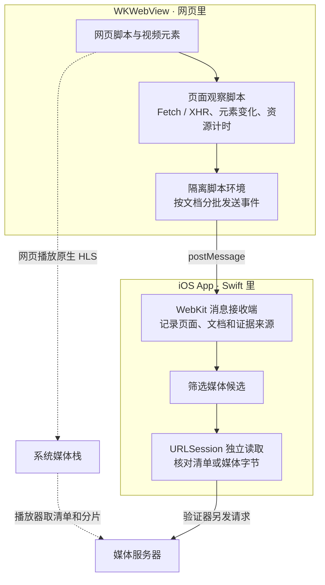

在电脑上，想知道一段网页视频到底从哪儿加载，有个很顺手的办法：给 Chrome 装上[猫抓（cat-catch）](https://github.com/xifangczy/cat-catch)，打开网页，点一下播放，再看扩展弹窗。页面加载的是 MP4 文件，还是一份以 `.m3u8` 结尾的播放清单，常常一眼就能找到。这就是我们想要的资源嗅探：**网页照常播放，人能看见播放器用了哪些资源。** 猫抓之所以能做到，是因为桌面浏览器会把请求事件交给扩展，由它从页面加载的众多资源里筛出媒体。

换到 iPhone，这套用法断在了第一步。[iOS Safari 支持扩展](https://developer.apple.com/safari/extensions/)，但不能直接安装桌面 Chrome 的扩展包，猫抓官方的安装列表里也没有 iOS Safari 版。我们想在个人项目 CrawlerBot 里保留“点播放就能找资源”的体验，于是让用户在 App 自己的 `WKWebView` 里打开网页。问题也随之变了：桌面浏览器会把请求事件交给猫抓，WebKit 会把这个页面的媒体请求交给 App 吗？

## 先试底层拦截：私有 API 能接管 WebView 的 HTTP 请求吗？

最初的想法很直接：如果请求和响应都会经过 App，那就可以在原样转发时顺手记下媒体地址。我们给实验定了两个条件：**App 要看到请求，网页和服务器也要像没有拦截器时那样正常通信。** 否则嗅探器记下的就是它自己改变过的流量。

如果读过 `WKURLSchemeHandler` 的文档，很自然会想：给 `https` 安装一个处理器，是不是清单和分片都会进入 App？Apple 的公开接口允许注册 WebKit 尚未处理的 scheme。实验里，自定义 scheme 能回调；用同一公开接口给 `https` 注册，则抛出 `NSInvalidArgumentException`。而 `WKNavigationDelegate` 告诉我们的是一次导航的进展，也不是每个子资源的响应。

下面三条路只存在于独立的实验 App。**前两条依赖 WebKit 私有入口；第三条改写的是一个公开方法，改写后的行为没有公开兼容保证。** 每条路线都在新进程里运行；对同一个测试请求，同时比对页面读到的结果、App 的回调和我们自己服务器的日志。

| 路线 | 具体碰了什么，原本想得到什么 | 实际看见了什么 |
|---|---|---|
| KVC（按名字访问内部属性） | 尝试读取 `WKWebViewConfiguration` 的私有键 `_urlSchemeHandlers`，让 HTTP(S) 也进入 scheme handler | 读取时抛出 `NSUnknownKeyException`。**安装失败**；依赖它的 POST、媒体等用例都被阻塞，没有换路线算通过 |
| 私有注册 + `NSURLProtocol` | `NSURLProtocol` 是 Foundation 的公开类；让 WebKit 把这类请求交给它，依赖私有类方法 `+[WKBrowsingContextController registerSchemeForCustomProtocol:]` | 回调里的方法仍写着 POST，但 JSON、表单、二进制原应有的 24、18、7 字节，到服务器全是 **0 字节**。307 重定向后的请求体也为空 |
| 运行时替换方法（swizzle） | 改写公开的 `+[WKWebView handlesURLScheme:]` 对 HTTP(S) 的判断，再测试 `WKURLSchemeHandler` 是否能承担转发 | 页面普通 POST 和 307 的字节这次正确了。但服务器收到 Cookie，并不代表 WebKit 的 Cookie 存储和网页可见值都正确；跨域测试里，页面读到了结果，服务器却没收到基线有的 OPTIONS 预检 |

**只看 HTTP 200，会漏掉什么？** 我们让同一段网页代码向测试服务器的 `/echo` 发送一份 24 字节的 JSON。下面是 iOS 27.2 模拟器三次独立运行的**服务器访问记录**，只选了六列。第一行数据是没装拦截器的对照；`marked=1` 表示服务器收到了原型转发时添加的标记。

```text
caseID method path status marked bodyBytes
baseline-post-post POST /echo 200 0 24
legacy-post-post POST /echo 200 1 0
swizzle-post-post POST /echo 200 1 24
```

三个请求都是 `POST /echo`，服务器也都回了 200。区别在最后一列：`NSURLProtocol` 转发的那次，服务器实际收到 **0 字节**。同一个 `caseID=legacy-post-post` 的 XCTest 输出是 `status=fail starts=1`：回调确实开始过一次，请求体也确实丢了。两份原件可对读：运行 `simulator-20261121-211625-33229-legacy-ProbeNetworkMatrixTests` 的 `.log:145` 和 `-origin.jsonl:26`。

swizzle 保住了这 24 字节，却没通过另一项对照。下面两行是测试宿主根据页面结果和服务器日志打印的原文。基线的服务器先收到 `OPTIONS`（204），再收到 `POST`（200）；swizzle 的同一用例只收到 `POST`（200），页面却依然读到了 `cors-allowed`：

```text
PROBE_RESULT route=baseline caseID=baseline-policy-cors-preflight status=pass starts=0 detail=response=cors-allowed,preflightObserved=true,methods=["OPTIONS", "POST"]
PROBE_RESULT route=swizzle caseID=swizzle-policy-cors-preflight status=fail starts=1 detail=response=cors-allowed,preflightObserved=false,methods=["POST"]
```

[查看实验日志摘录：XCTest 与服务器逐条记录](interception-log.txt)。按上面的 caseID 就能找到匹配的请求。附件也保留了 KVC 的安装异常：模拟器 `simulator-20261121-211558-31903-kvc-ProbeForwardingTests.log:47` 报 `NSUnknownKeyException`，说明是取不到 `_urlSchemeHandlers`；该组 4 项跳过，未生成源站日志。附件列出了模拟器和真机的运行编号、原始行号，以及原日志的 SHA-256。

为什么不满足于“安装成功”？一张静态图片太容易让错误实现看起来能用。**取消**慢请求时，`NSURLProtocol` 路线先发完数据，才收到停止；swizzle 在显式停止时有效，但仅释放 WebView 时请求仍会跑完。**原生 HLS** 则给出了正例。HLS 把视频拆成许多短片段，由清单告诉播放器去哪里取。在本地两秒、未加密的样本里，两条能安装的路线都观察到了主清单、变体清单和分片，服务器日志也能对上。这个正例只覆盖这段素材，不能推到直播、加密内容或任意 CDN。

这次 HLS 的成功也有网络记录。模拟器 `legacy-hls` 用例的日志原文里有下面这个字段；三个数依次是**服务器实际收到的次数 / 带转发标记的次数 / App 开始处理的次数**。这里能说“两个分片都经过了转发”，依据是每个路径的三项计数能对上，而不只是视频画面动了。

```text
origin/tagged/starts=["/hls/master.m3u8=1/1/1", "/hls/variant.m3u8=1/1/1", "/hls/segment-0.ts=4/4/4", "/hls/segment-1.ts=2/2/2"]
```

**Worker** 还要分清是谁在发请求。Dedicated Worker 是页面启动的独立脚本，测试中可以加载并联网。Service Worker 则可以接管页面请求、自己用缓存回答：默认实验配置没有这个能力，记作 `blocked`；把测试域名加入 App-Bound 范围后，基线和 `NSURLProtocol` 路线都观测到首次到站、第二次命中缓存，而 swizzle 路线上 Worker 注册后始终未在测试时限内接管页面，这项是 `fail`。没有到站可能只是缓存命中；反过来，只有源站确实收到某个请求、相应回调却没出现，才有依据把它记为 `bypass`。

这组实验跑在 **iOS 27.2 模拟器和 27.2.1 真机**。最低部署目标是 26.0，但这三条路线在 iOS 26.x 上的运行结果、以及受信任 HTTPS 测试服务器上的结果，都还没有验证。

这几次对照改变了我们的选择。原本只是想知道视频地址，接管请求却可能让服务器收到空的 POST，或让网页少发一次跨域预检。**三条路线都没达到通用拦截的要求**：KVC 没装上，另两条能看到部分媒体流量，却没保住网页原有的行为。它们留在了实验原型里。回到最初的需求，如果网页或播放器已经知道资源地址，能不能直接在那里读到它？

## 最终方案：在页面里找资源，交给 Swift 验证

**Example 的资源嗅探最终只用了公开 API。** `WKWebView` 照常加载网页；App 在文档开始时注入脚本，观察页面请求、元素变化和播放器提供的信息。Swift 收到的是带来源的资源线索；需要验证时，才用 `URLSession` 另发请求。我们在 iOS 26.0 模拟器上用 Example 扫描到了公开视频的媒体候选。它能观察的是 App 里打开的页面，用户在 Safari 里打开的其他标签页不在范围内。

图里的实线是一次资源发现和验证的过程。虚线是用户点播放后，系统媒体栈自己取清单、取分片的路径：即使两个客户端访问同一台服务器，也不能把实线上的响应算成拦到了虚线上的请求。



**先把脚本放对位置。** 创建 WebView 之前，我们把 `WKUserScript` 加入配置，同时覆盖主文档和嵌套的子页面（frame）。假设 `observerSource` 是观察脚本的源码，决定它能否看见网页调用的，是下面这几行：

```swift
let config = WKWebViewConfiguration()
let observer = WKUserScript(source: observerSource,
                            injectionTime: .atDocumentStart,
                            forMainFrameOnly: false,
                            in: .page)
config.userContentController.addUserScript(observer)
let webView = WKWebView(frame: .zero, configuration: config)
```

`.atDocumentStart` 让脚本在文档刚开始时就位；等 `WKNavigationDelegate.didFinish` 再装，会错过页面启动时的请求。`.page` 同样关键：两个脚本环境虽然看到同一棵 DOM（页面元素树），却各自有一份 JavaScript 全局变量。在隔离环境里包装自己的 `window.fetch`，网页调用的仍是它原来的那个函数。

**再看页面实际做了什么。** 以一次 Fetch 为例：包装函数先把调用交给浏览器原来的 `fetch`，记下请求地址和方法；等响应回来，读出页面本来就能读到的状态码、最终 URL 和内容类型，再把原响应交还给网页。我们默认不读正文。明确开启清单文本采集时才限量读取响应的副本；直接读取原响应的流，会把留给网页的数据提前消费掉。XHR（`XMLHttpRequest`）走另一条观察路径，所以只包装 Fetch 会漏掉用 XHR 的播放器。

同一个视频可能留下几种记录。我们给每条记录标明来源，因为它们能回答的问题不同：

| 线索从哪里来 | 它能告诉我们什么 | 单凭它还不知道什么 |
|---|---|---|
| Fetch / XHR 的响应 | 网页读到了哪个最终地址、什么状态和类型 | 换成原生客户端能否取得相同内容 |
| DOM 的元素或属性发生变化（`MutationObserver`） | 例如播放器刚给 `<source>` 填了地址，或阅读页把占位图换成了正文图 | 浏览器是否真的请求过它；图片列表是否完整 |
| 浏览器的资源计时（`PerformanceObserver`） | 浏览器为某个 URL 留下了加载记录，可用来和播放器报告的尺寸相互核对 | 完整的请求头、响应体，或所有媒体分片 |
| 媒体源扩展（MSE）和 `blob:` | 页面创建了一个本地媒体对象，可能还能知道缓冲区使用的编码 | 不能从 `blob:` 反推出 CDN 地址，也不能把这个字符串交给 `URLSession` 下载 |

**最后才把观察结果变成候选。** 页面把资源事件交给隔离环境里的桥接脚本，由它分批调用 WebKit 的 `postMessage`。Swift 端用 `WKScriptMessageHandlerWithReply` 接收，核对 WebView、frame 和当前文档，再把事件交给订阅者。发起播放前先订阅，翻页或关闭时结束旧等待。否则很容易漏掉第一个响应，或者把上一页迟到的请求记到下一页。队列有上限；发生丢弃时，空列表也不能用来证明页面没发请求。

通用媒体选择器的门槛很具体：**HTTP(S) 地址、页面脚本可见的 2xx 响应、能识别的媒体类型**。它按最终地址或内容类型识别 HLS、MP4、FLV，把 HLS 分片排除在入口候选之外。比如 DOM 里有 `film.m3u8`，此时只记“页面提到它”；若随后 Fetch 返回 200，它才可能进通用候选列表。站点适配器也可以读取播放器明确提供的线路，但要保留这份证据的来源，不能补造一条从未看见的网络响应。

## 视频已经在播，为什么一条清单响应也没看到？

我们在 iPhone 模拟器里打开苹果的 [Advanced Stream HEVC 样例](https://developer.apple.com/streaming/examples/advanced-stream-hevc.html)。它的 HLS 主清单列出不同分辨率、码率的**变体**，每个变体又有自己的分片清单。在这个页面上，我们做了两次对照：

1. **在网页里点播放。** 时间向前走，但页面 Fetch/XHR 观察器没有报告清单响应。原生播放可以由系统媒体栈取数据，不必调用页面的 `window.fetch`。这一次的“0”描述的是观察器，不能解释为网络上没有请求。
2. **让页面主动 Fetch 已知的清单地址。** 这次观察器收到 HTTP 200，并从响应生成了 HLS 候选。主清单列出 **54 个变体**。这是一次新请求；54 是可选项数，既不是拦下了 54 次请求，也不是测出了播放器当前的码率。

这是 `testApplePublicHLS()` 留在 Xcode 结果包里的两行输出。第一行数的是**观察器收到的响应**；第二行数的是**主动 Fetch 拿到的那份清单里的选项**。这是客户端证据，我们没有 Apple CDN 的服务器访问日志。

```text
Live counts: native player manifest response events 0
Live counts: HLS status 200, variants 54, distinct bandwidths 54
```

如果问题变成“播放器刚才实际选了哪一档”，该看什么？我们换了一段 [Apple WWDC 演讲视频](https://developer.apple.com/videos/play/wwdc2021/10036/)。模拟器里视频的 `currentSrc` 已变成 `blob:`，但之前记录的 HTTPS 视频地址与页面声明的 `og:video` 一致。沿这个地址取得的主清单有 **12 个**视频变体。资源计时里实际出现的一条变体 URL 与播放器报告的 3840 × 2160 相符，这次才有证据判断它播了哪条。单看尺寸仍区分不了相同分辨率的不同码率。

在 WWDC 页，我们又**单独指定了 360p**：`URLSession` 成功读取清单，再用 Range 请求拿到首片前 2048 字节（HTTP 206）。Mac 上的独立下载器随后取回初始化段和第一个视频分片，解出 180 帧 640 × 360 的画面。这样既证实了候选能交给另一个客户端，也划出了实验的终点：没下载整段演讲，更没有把手选的 360p 当成播放器刚刚自动选中的线路。

可以在[公开方案的客户端日志摘录](public-log.txt)里找到显式选档那次的 `stage=first-segment`：模拟器与真机都记录了 `variant=200 segment=206 bytes=2048`，两端那 2048 字节的 SHA-256 也相同。这两行证明的是首片前缀；180 帧是当时 Mac 下载器的另一次验证，见文末的交接记录。

交接时，URL 往往只够描述一半。网站可能还需要来源页请求头（Referer）或会话 Cookie。我们的原生读取默认不带 Cookie；显式开启时，只带 App 导入当前会话、仍有效且与目标匹配的值。重定向换了目标，就重新判断该带哪些头。**网页上能播、复制出来却读不到**，应先核对这两次请求的上下文，不能靠导出整份网页登录状态来补。

## 换一类资源：怎么知道一章漫画真的找齐了？

对视频有用的是播放器和清单；对漫画有用的是阅读器维护的**页序**。直接收集屏幕上所有 ``，会把封面和占位图算进去，还可能漏掉尚未滚入视口的后半章。我们让 WebView 等到章节数据就绪，用页面解析规则生成图片列表，再和阅读器自己的有序数组逐项比对。两份列表一致且非空，才交给原生下载器逐页解码；整章成功才替换旧章。

在真机上，我们从 Example 首页下载《读西游记》和《卖火柴的毛毛》，结束 App，再从只读本地文件的书架逐页翻到 **8/8 和 7/7**。[真机 XCTest 摘录](public-log.txt)里，对应的 `testDownloadsAndReadsEightPageChapterOffline()` 和 `testDownloadsAndReadsSevenPageChapterOffline()` 都是 `Passed`。没有切换飞行模式，也没有据此推断整站都能下载。这个例子解释了为什么要为每类资源单独定验收条件：视频的首片能解码，不能证明整章图片找齐；拿到八个 URL，也不能证明重开 App 还能读。

## 遇到空结果，先看页面走到了哪一步

在 Example 的代理浏览页里，W3C 的公开样例能加载，点击扫描后也能看到候选；同一台模拟器上的另外两个站点却返回 HTTP 403，显示人工验证页。代理接受了连接，只能说明隧道建成；这一轮应记作“页面访问受阻”。

在 XPTV 视频订阅里，有的源直接返回 JSON 和线路地址，根本不需要嗅探。需要运行已审核规则的源才用网页里的 Dedicated Worker；线路是否可播，再交给手机上的 `AVPlayer` 验证。以荐片为例，[真机端的记录](public-log.txt)里，第一条线路报 `NSURLErrorDomain/-1003`，1 次上游请求、0 份清单。单独选第三条后收到了 3 份清单，跳播后取到了帧，播放时钟从 7.015 秒走到 7.527 秒。两条结果分别保留。

这次迁移留下来的一条判断标准是：**先问用户点完按钮后要得到什么，再选观察点。** 要列出可选画质，就读清单；要指出当时播放的线路，就核对播放器和实际加载记录；要做离线阅读，就重新打开本地成品。过去用 Puppeteer 或 Playwright 时，这几件事都围着桌面浏览器的 `page` 对象做。到了手机上，让网页提供它知道的地址，再让原生客户端验证读者真正要用的资源，就够完成这些任务了。

## 想对照实现或复验

两份随文附件都可以直接打开：[受控 HTTP 实验的回调和源站记录](interception-log.txt)、[公开站点的设备端日志与 XCTest 结果](public-log.txt)。它们摘自 2026 年 11 月 21–22 日留存的原件；这次补文重新读取了日志和结果包，没有重新访问这些站点。自建服务器的请求可以两端对账；第三方站点只能给出客户端看见的事实。

如果手边有 CrawlerBot 仓库，在快照 `6a121640` 的根目录运行下面一条命令，能从已入库的服务器记录重做上面的 POST 对照，不需要启动模拟器：

```sh
awk -F '\t' 'NR==1 || ($1 ~ /^simulator-/ && $2 ~ /^(baseline|legacy|swizzle)-post-post$/) {
  print $2, $3, $4, $5, $6, $7
}' prototypes/wkwebview-interception/evidence/2026-11-21/origin.tsv
```

- Apple 的公开接口：[WKUserScript](https://developer.apple.com/documentation/webkit/wkuserscript)、[WKContentWorld](https://developer.apple.com/documentation/webkit/wkcontentworld)、[WKScriptMessageHandlerWithReply](https://developer.apple.com/documentation/webkit/wkscriptmessagehandlerwithreply)、[自定义 scheme 的注册限制](https://developer.apple.com/documentation/webkit/wkwebviewconfiguration/seturlschemehandler%28_%3Aforurlscheme%3A%29)。
- 在 CrawlerBot 快照 `6a121640` 中，从 `ios/CrawlerBot/Classes/Resources/CrawlerBotScriptLoader.swift:25` 看注入位置，从 `ios/CrawlerBot/Assets/Runtime/CrawlerBotFetchXHR.js:78` 看一次真实的 Fetch，再到 `ios/CrawlerBot/Classes/Resources/CrawlerBotResourceEvent.swift:147` 看候选的最低门槛。
- 同一快照中，`docs/ios-wkwebview-automation.md` 记录了 HEVC 样例的 0 条响应与 54 个变体；`prototypes/wkwebview-interception/evidence/2026-11-21/public-page-handoff.md` 保留了 WWDC 交接结果；`docs/2026-11-21-wkwebview-private-interception-validation.md` 列出私有实验的逐项结果、源站记录和复现命令；两章漫画重开后的验收见 `ios/Example/Manhuaren.md`。
- 代理浏览与订阅点播的对照分别见 `ios/Example/ProxyBrowser.md` 和 `ios/Example/XPTVSubscriptions.md`。
